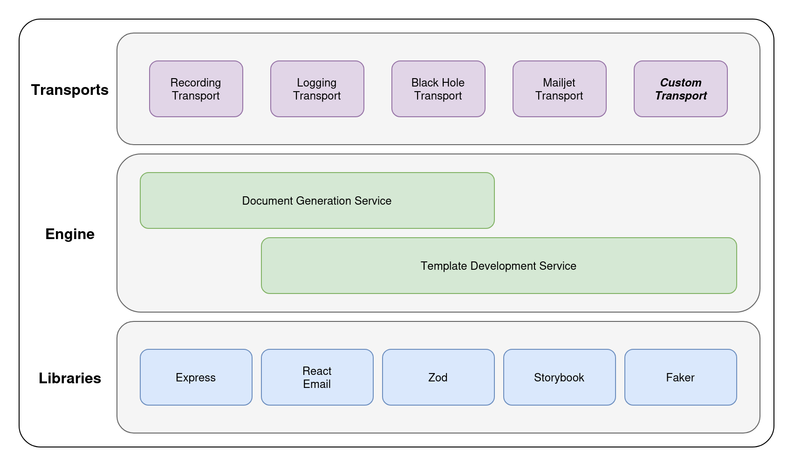
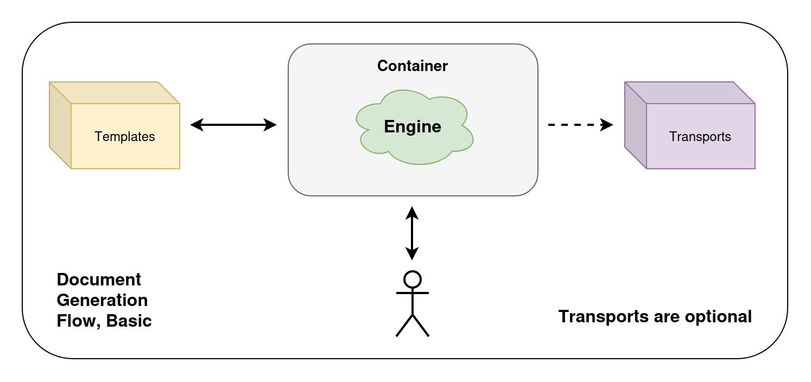

# Architecture

How mailjot is put together and why. For usage see the [README](../README.md); for requirements see [spec/SystemSpec.md](spec/SystemSpec.md).

Terms: a **template** is an email yet to be built; a **document** is a template that has been built (subject, HTML, plaintext); a **message** is a document plus its envelope.

## Design principles

- **The filesystem is the registry.** Templates, transports and API versions are discovered from directories. Adding a template or a transport never changes the engine.
- **One version number, `X`,** covers the API prefix `/v[X]`, the engine routing bundle `engine/routers/v[X]/`, and the dynamic directories `templates/v[X]/` and `transports/v[X]/`. A version is a complete set, with no fallthrough to an earlier one, and a released version is frozen.
- **The generic engine knows no version's contract.** Each version's router resolves its own templates, transports, envelope and sender.
- **All or nothing.** Input is validated strictly before rendering; HTML and plaintext come from the same component; a document that fails an integrity check is an error, never a partial success.
- **Failures are values at the plugin boundary.** Transports return `{ ok: false }` instead of throwing, and internals are logged, never returned.

## Overview

### The stack

Transports sit on top. Below them are two views of the same engine: the generation service (the API that builds and sends documents) and the template development service. Both rest on the libraries underneath (Express, React Email, Zod, Storybook, Faker).



### The basic flow

A caller makes a request to the engine, which runs in a container. The engine reads templates from the mounted templates directory, builds the document, and returns it. If the request is a send, the engine also hands the message to a transport (dashed, because transports are optional).



## Components

```
engine/                      version-agnostic
  index.ts                   entry: reads env, checks TEMPLATES_DIR, starts the server
  app.ts                     Express app: /healthz, /, mounts each version router, 404 and error handlers
  auth.ts                    bearer-token middleware
  logger.ts                  the engine's logger (pino): JSON lines, levels, redaction, error serializer (Node-only)
  requestLog.ts              request ID, `req.log` and the access line (Node-only)
  discovery.ts               walks a version directory to find templates
  loader.ts                  template loader: imports a template, checks the contract, caches it
  transport.ts               transport discovery and loader (v[X] contract supplied by the router)
  render.ts  integrity.ts    build a template into a document; integrity checks
  schema.ts  validation.ts   JSON Schema from Zod; input validation and field errors
  template.ts  errors.ts     template contract types; error classes and response shapes
  versions.ts                finds engine/routers/v[X] directories and the matching router.ts
  routers/v1/                the v[1] router bundle
    router.ts                routes for /v1 (default export, discovered by the engine)
    envelope.ts              provider-neutral delivery envelope
    sender.ts                build-and-send pipeline and its flat error shape
    transport.ts             transport contract: plugin types, plus the engine's runtime check
templates/v1/<group>/<name>/ v[1] templates (mounted in production)
transports/v1/<Name>/        v[1]transports (mounted in production)
```

`render.ts`, `integrity.ts`, `schema.ts`, `validation.ts`, `errors.ts` and `template.ts` also run in the browser inside Storybook, so they use no Node-only modules or globals (guarded by `engine/browser-safe.test.ts`).

## Startup

1. `index.ts` creates the logger (so even a startup failure is a structured line), resolves `TEMPLATES_DIR` and `TRANSPORTS_DIR` and exits if the templates directory is unreadable.
2. `app.ts` lists the `v[X]` directories under the templates directory.
3. For each, it loads `engine/routers/v[X]/router.ts`. A version directory with no router stops startup.
4. It calls the router with a `VersionContext`: `version`, `templatesDir`, `transportsDir`, `env` and `logger` (the engine's logger, scoped to that version).
5. The router builds its own template loader and transport loader, logs which transports are available, and returns an Express router that the app mounts at `/v[X]`.

## Request flows

### Render: `POST /v[X]/render/{template}`

```
request → JSON body (1 MB limit) → find template → import and check contract
        → validate input (Zod, strict) → render HTML and plaintext (timeout)
        → build subject → integrity checks → document
```

A validation failure is `422` with field-level errors. Unknown templates are `404`. A throwing component, a failed integrity check or an unusable template is a generic `500`, with details only in the log.

### Send: `POST /v[X]/sender/{transport}/{template}`

```
request → transports/v[X] has any? (else 404) → bearer auth (else 401)
        → parse body → resolve transport (404 unknown, 503 missing config)
        → validate envelope and options (flat 400)
        → build the document (flat 400 with sub_error)
        → dryRun? stop with the validated result
        → transport.send(message) → 200, or 502 if rejected or unreachable
```

Ordering rules:
- Authentication comes before anything else is done with the request.
- Nothing is sent unless the document builds fully and the envelope is valid.
- Building and delivery are separate: a transport receives the finished document and cannot influence how it was built.

## Templates

A template exports `schema`, `metadata`, `subject`, a default React Email component and `examples`. The loader imports it, checks the contract and caches the result. Its identity is its directory path within the version, and `metadata.version` must be semver with a major matching the directory. The Zod schema is the single source for validation, TypeScript types and the JSON Schema served at `/v1/schemas/{template}`.

## Transports

A transport is a directory with `transport.tsx` exporting `metadata`, `config` (Zod over environment variables), optional `options`, and a default `send(message)`. The router's contract (`transportContractV1`) validates the module when it loads.

- Transports `import type` from the contract only, never engine code at runtime, so they compile and deploy separately.
- Config is validated at load. A transport with bad config is listed as unavailable and answers `503`; the engine keeps running.
- The shared envelope is owned by the engine. Provider specifics go in `options` and stay inside the transport's directory.
- Built in: `Mailjet` (delivers); `Logging`, `Recording` and `BlackHole` (deliver nothing).

## Errors

Most routes return `{ error: { code, message, details? } }`. The sender's build-layer, envelope, options and request problems are a flat `400`: `{ error, sub_error?, description, fields? }`. Full tables are in the [README](../README.md) and [Sending.md](Sending.md).

## Build and deployment

| Artifact | Built by | Output | Production |
| --- | --- | --- | --- |
| Engine and routers | `engine-compiler` (`tsconfig.engine.json`, composite) | `dist/engine/` | In the image |
| Templates | `template-compiler` | `dist/templates/` | Mounted read-only at `/app/templates` |
| Transports | `transport-compiler` (references the engine project for the contract types) | `dist/transports/` | Mounted read-only at `/app/transports` |

The three release independently; a new router or contract version is the exception, since routers ship inside the engine image. Mounted code resolves `zod` and `react` against the engine's `node_modules`. `npm start` runs the compiled output with `TEMPLATES_DIR=dist/templates` and `TRANSPORTS_DIR=dist/transports`; `npm run dev` runs the TypeScript source through `tsx`.

## Module cache

Node caches imported modules and has no public way to unload one. Consequences:

- The sender routes check on every request whether `transports/v[X]/` contains any transport, so adding one needs no restart.
- Editing a template or transport that has already loaded needs a restart. A file that failed to load is retried only if the failure was a syntax error; one that imported and then failed the contract or threw stays cached until restart.

## Logging

`index.ts` creates the one logger (`logger.ts`, pino, configured from `LOG_LEVEL`) and passes it to `createApp`, so a test can inject its own. Three scopes hang off it:

```
logger                                  startup, the final 500 handler
  └─ requestLog (mounted first)         req.log = logger.child({ request_id })   + one `mailjot.request` line per response
       └─ per-version mount             req.log = req.log.child({ api_version }) + res.locals.mount = "/v1"
            └─ router                   logs through req.log (VersionContext.logger only for startup lines)
                 └─ transport           message.logger = req.log.child({ transport, template })
```

Every response carries an `X-Request-Id` header, every line a request produces carries the same `request_id`, and a transport's own lines carry the transport and template without it having to know. Send your own `X-Request-Id` (letters, digits, `.`, `_` and `-`, up to 64 characters) to tie a request to your system's trace; anything else is replaced with a generated ID, never echoed. Each request ends with one `mailjot.request` line: the method, the matched route pattern (not the URL), the status, the duration and the size of the response, plus the `template` and `transport` once resolved. It is `warn` for a 4xx and `error` for a 5xx. The health check (`/healthz`) is logged at `debug` only.

| Event | Level | When |
| --- | --- | --- |
| `mailjot.listening`, `mailjot.startup.failed` | info, fatal | the engine started, or could not |
| `mailjot.sender.ready`, `mailjot.transport.status` | info (warn if authentication is off) | at startup, when transports exist |
| `mailjot.send.ok` | info | a message was sent (`dry_run` says whether anything actually was) |
| `mailjot.send.failed` | error | a transport refused or could not deliver (`reason`) |
| `mailjot.auth.rejected` | warn | a sender request had no valid token |
| `mailjot.render.failed`, `mailjot.template.unloadable`, `mailjot.template.contract_violation` | error / warn | a template failed to build or load |
| `mailjot.transport.unavailable`, `mailjot.transport.contract_violation` | warn / error | a transport is not configured, or is broken |
| `mailjot.transport.<name>.*` | varies | what a transport itself reports (for example `mailjot.transport.mailjet.rejected` with Mailjet's error codes) |
| `mailjot.error.unhandled` | error | anything unexpected, with the cause |

Rules the design depends on:
- The render path (`render.ts`, `integrity.ts`, `schema.ts`, `validation.ts`, `errors.ts`, `template.ts`) never logs and never imports the logger: it runs in the browser inside Storybook and reports problems by throwing. The router logs what it throws. The logger and request log are Node-only.
- The sender logs what happened, not what was sent: never the envelope, subject, bodies, credentials, headers, the raw URL, or a provider's response or error text. `bearerAuth` knows nothing about logging; the router wraps it and logs a rejection.
- A render failure is logged once, by the router's error handler, for both the render and the sender routes (the sender attaches the `RenderError` as the `cause` of its flat 400).
- Transports receive the logger on the message (`TransportMessage.logger`, a small `TransportLogger` interface, so they never depend on pino) and still only `import type` from the engine.
- `engine/canary.test.ts` runs secrets, recipients and provider echoes through the whole system and fails if any reaches the log.

## Security model

- Only the sender routes are authenticated: one shared bearer token (`MAILJOT_TRANSPORT_AUTH_TOKEN`, at least 16 characters). With none configured, every sender request gets `401`.
- Request bodies are limited to 1 MB; server timeouts are tightened; rendering has a timeout (`RENDER_TIMEOUT_MS`).
- Internals (paths, stack traces, provider credentials, missing-variable names) never appear in responses. They go to the log, which in turn never receives request bodies, recipients, credentials or a provider's response text (see "Logging").
- There is no built-in rate limiting. Run the service behind a proxy that provides it, with stricter limits on `/v1/sender`.

## Testing

Tests are deterministic and use no network or real credentials. `engine/contract.test.ts` runs every discovered template and transport through the contract, so a new one is covered without registering it. Deliberately broken modules live in `test/fixtures/` and never in `templates/` or `transports/`. See [Testing.md](Testing.md).

## Extending

| To add | Do | Engine change |
| --- | --- | --- |
| A template | New directory in `templates/vN/`; see [Authoring.md](Authoring.md) | None |
| A transport | New directory in `transports/vN/`; see [Sending.md](Sending.md) | None |
| An API version | Copy `templates/vN`, `transports/vN` and `engine/routers/vN` to `vN+1` and make the breaking changes there | None to the generic engine; update tests and docs |
